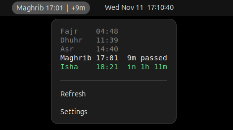

# Prayer Times Panel for Muslimtify

Unofficial GNOME Shell extension (46–50) that shows the next prayer in the top bar:

```
Asr 14:40  |  1h 21m        # counting down
Dhuhr 11:39  |  +12m        # for N minutes after a prayer starts
```

Click for today's prayer list. Times come from the [`muslimtify`](https://github.com/muslimtify-org/muslimtify) CLI ([website](https://www.muslimtify.org/)), which must be installed and print local time.

## Screenshots

**Top bar**


**Prayer times panel**



## Install

```sh
./install.sh
gnome-extensions enable muslimtify@abdulazizumarovich.github.io   # after re-login on Wayland
```

## Settings

`gnome-extensions prefs muslimtify@abdulazizumarovich.github.io`: shift window, colors, and CLI path (set a full path if the shell can't find `muslimtify` in `PATH`).

## License

GPL-3.0-or-later
